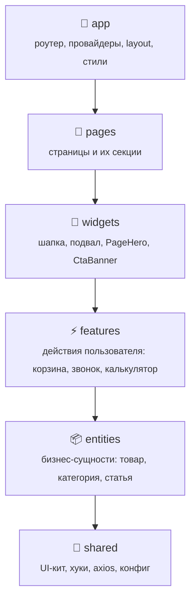
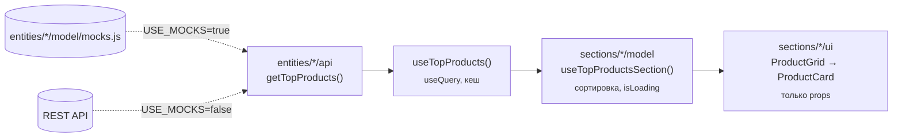
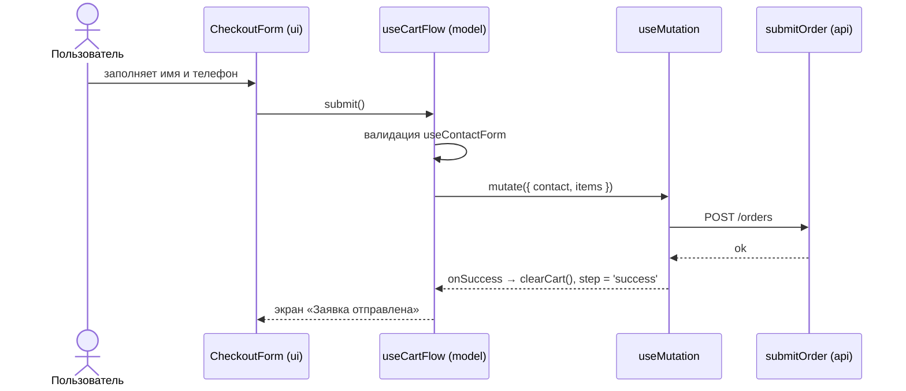

<div align="center">

# 🧱 Мастер Строй

**Сайт-магазин производителя тротуарной плитки — учебный проект на React + Feature-Sliced Design**


</div>

---

## 📖 О проекте

«Мастер Строй» — сайт вымышленного производителя тротуарной плитки из Волоколамска. Он вырос из одного макета главной страницы: каталог, топ товаров с калькулятором, заявка, обратный звонок и несколько внутренних страниц.

> [!NOTE]
> **Это учебный проект.** Его цель — на живом примере показать, как устроить React-приложение по **Feature-Sliced Design**: где хранить данные, где логику, а где разметку, и как всё это связать, чтобы проект было легко расширять.

### Чему здесь можно научиться

- 🗂 **Feature-Sliced Design** — слои, слайсы, сегменты и правила импортов между ними.
- 🧩 **«Тупые» компоненты.** UI получает всё через props, а логика живёт в хуках в `model/`.
- 🔄 **Серверное состояние на TanStack Query:** `useQuery` для чтения, `useMutation` для отправки форм.
- 🌐 **Слой API на axios с моками.** Фронтенд работает без бэкенда, а переключение на реальный API — одна переменная окружения.
- 🧭 **Маршрутизация на React Router 7:** ленивые страницы, хлебные крошки, якоря между страницами.
- 🛒 **Глобальное состояние без Redux:** корзина на `useSyncExternalStore` с сохранением в `localStorage`.
- ✨ **Анимации на чистом Tailwind:** появление при прокрутке, анимации закрытия модалок и уважение к `prefers-reduced-motion`.
- ♿ **Доступность:** фокус в модалках, `aria-*`, управление с клавиатуры и ссылка «Перейти к содержимому».

---

## ✨ Возможности

| Страница | Что внутри |
| --- | --- |
| **Главная** `/` | Hero с бесконечно «поднимающейся» брусчаткой, каталог, «О нас», топ товаров с выбором цвета и сортировкой, «О производстве» с видео, галерея работ с лайтбоксом, преимущества |
| **Укладка** `/installation` | Прайс, этапы работ, интерактивная схема слоёв основания, калькулятор стоимости укладки, FAQ |
| **Полезно знать** `/articles` | Статьи с фильтром по рубрикам и поиском |
| **Статья** `/articles/:slug` | Полоса прогресса чтения, «Поделиться», «Читайте также» |
| **Доставка и оплата** `/delivery` | Выбор зоны доставки с ценой и сроком, транспорт, этапы, способы оплаты, FAQ |
| **404** | Для любых несуществующих адресов |

**Сквозные фичи:**

- 🧮 **Калькулятор товара** — цвет, площадь, запас 5 % на подрезку. Сразу видно, сколько штук понадобится и сколько это стоит.
- 🛒 **Заявка (корзина)** — выезжающая панель: изменение площади, удаление с кнопкой «Вернуть», оформление с формой.
- 📞 **Обратный звонок** — модалка с маской телефона, валидацией и экраном успеха.
- 📌 **Шапка** — прилипает при прокрутке и подсвечивает текущий раздел. На телефонах меню выезжает сбоку.
- 🔔 **Тосты, кнопка «Наверх» и полоса загрузки страниц.**

---

## 🚀 Быстрый старт

Нужен **Node.js 20.19+ или 22.12+** (требование Vite 8).

```bash
npm install      # установить зависимости
npm run dev      # dev-сервер на http://localhost:5173
```

| Команда | Что делает |
| --- | --- |
| `npm run dev` | Запускает dev-сервер с горячей перезагрузкой |
| `npm run build` | Собирает продакшен-сборку в `dist/` |
| `npm run preview` | Показывает собранную версию локально |
| `npm run lint` | Проверяет код ESLint |

### Переменные окружения

Скопируйте `.env.example` в `.env.local`:

| Переменная | По умолчанию | Назначение |
| --- | --- | --- |
| `VITE_API_URL` | `/api` | Базовый URL бэкенда для axios |
| `VITE_USE_MOCKS` | `true` | `true` — данные берутся из моков, `false` — из реального API |

---

## 🏛 Архитектура: Feature-Sliced Design

Код разложен по **слоям**. Слой может импортировать только из слоёв **ниже** себя: `app` → `pages` → `widgets` → `features` → `entities` → `shared`. Благодаря этому изменения не расползаются по проекту, а каждый кусок кода легко найти.



### Структура `src/`

```text
src/
├── app/                    # Точка сборки приложения
│   ├── layouts/            #   RootLayout: шапка, <Outlet/>, подвал, глобальные модалки
│   ├── providers/          #   QueryProvider (TanStack Query)
│   ├── router/             #   Маршруты с ленивой загрузкой страниц
│   └── styles/             #   Tailwind и глобальные стили
│
├── pages/                  # Страницы — каждая собирается из секций
│   ├── home/
│   ├── installation/
│   ├── articles/
│   ├── article/
│   ├── delivery/
│   └── not-found/
│
├── widgets/                # Крупные самостоятельные блоки, общие для страниц
│   ├── header/  footer/  page-hero/  cta-banner/
│
├── features/               # Пользовательские сценарии
│   ├── cart/               #   Заявка: стор, панель, оформление
│   ├── configure-product/  #   Калькулятор товара (цвет + площадь)
│   └── request-callback/   #   Заказ обратного звонка
│
├── entities/               # Бизнес-сущности
│   ├── product/  category/  article/
│
└── shared/                 # Переиспользуемое, без бизнес-логики
    ├── api/                #   axios-клиент, флаг USE_MOCKS
    ├── assets/             #   Общие ассеты (узор брусчатки)
    ├── config/             #   Контакты, меню
    ├── lib/                #   Хуки и утилиты
    └── ui/                 #   UI-кит: Button, Modal, Drawer, Reveal, иконки…
```

### Сегменты внутри слайса

Каждый слайс делится на **сегменты** по назначению:

| Сегмент | Что в нём лежит | Пример |
| --- | --- | --- |
| `ui/` | React-компоненты, только разметка | `ProductCard.jsx` |
| `model/` | Хуки состояния, бизнес-логика, контент, моки | `useCartFlow.js`, `content.js` |
| `api/` | Запросы через axios и хуки react-query | `productApi.js`, `queries.js` |
| `lib/` | Чистые функции-помощники | `calculateOrder.js`, `formatPrice.js` |
| `config/` | Константы | `AREA_PRESETS`, `RESERVE_RATE` |
| `index.js` | **Публичный API слайса.** Снаружи импортируют только отсюда | `export { ProductCard } from './ui/ProductCard'` |

### Страница = набор секций

У каждой секции своя папка, а её `ui/` и `model/` лежат рядом. Всё, что относится к разделу, находится в одном месте:

```text
pages/home/
├── index.js                     # export { HomePage }
├── ui/HomePage.jsx              # только перечисляет секции по порядку
└── sections/
    └── top-products/
        ├── index.js             # export { TopProductsSection }
        ├── model/
        │   ├── content.js       # тексты, опции сортировки
        │   ├── sortProducts.js  # чистая функция
        │   ├── useTopProductsSection.js
        │   └── useProductSelection.js
        └── ui/
            ├── TopProductsSection.jsx   # собирает компоненты, логики нет
            ├── ProductGrid.jsx
            └── ProductQuickView.jsx
```

> [!TIP]
> **Правило большого пальца.** Если в `.jsx` появляется `useState` с бизнес-смыслом, расчёт или запрос, всё это уезжает в `model/`. Компонент получает готовые данные и колбэки.

---

## ⚙️ Как это работает

### Поток данных

Данные всегда идут одним путём: **API → react-query → хук секции → тупой компонент**.



```js
// entities/product/api/productApi.js
export async function getTopProducts() {
  if (USE_MOCKS) return TOP_PRODUCTS_MOCK          // работаем без бэкенда
  const { data } = await apiClient.get('/products/top')
  return data
}
```

### Отправка форм

Заявка и обратный звонок отправляются через `useMutation`. Валидация и маска телефона общие: они лежат в `shared/lib/useContactForm` и `shared/lib/phone`.



### Глобальное состояние без библиотек

Корзине, модалке звонка и тостам нужно состояние, доступное из любого места. Вместо Redux или Zustand используется маленький стор на встроенном `useSyncExternalStore`:

```js
// features/cart/model/useCart.js
const items = useSyncExternalStore(cartStore.subscribe, cartStore.getSnapshot)
```

- `features/cart/model/cartStore.js` — позиции заявки и синхронизация с `localStorage`.
- `shared/lib/createToggleStore.js` — фабрика флагов «открыто/закрыто». Модалку звонка можно открыть из шапки, подвала или калькулятора одним вызовом `openCallbackModal()`.
- `shared/lib/toast.js` — очередь уведомлений.

### Маршрутизация

Маршруты описаны в `app/router/routes.js`. Каждая страница грузится **лениво**, в отдельном чанке:

```js
{ path: 'delivery', lazy: page(() => import('@/pages/delivery'), 'DeliveryPage') }
```

- Ссылки вида `/#about` ведут к секции главной с любой страницы: `ScrollRestoration` сам прокручивает к якорю.
- `AppLink` из `shared/ui` сам решает, что рендерить: `<a>` для якоря на текущей странице или `<Link>` для перехода через роутер.

### Анимации

| Что | Как устроено |
| --- | --- |
| Появление при прокрутке | `<Reveal>` + `useInView` (IntersectionObserver, срабатывает один раз) |
| Закрытие модалок и панелей | `usePresence` держит компонент смонтированным, пока идёт анимация закрытия |
| Бесконечная брусчатка в hero | SVG-тайл с наклоном `atan(1/3) ≈ 18.4°` — при таком угле кладка становится бесшовной по обеим осям |
| Уважение к пользователю | В `index.css` при `prefers-reduced-motion` все анимации отключаются |

---

## 🧑‍💻 Как добавить новую секцию

1. Создайте папку `src/pages/<page>/sections/<section>/` с подпапками `ui/` и `model/`.
2. В `model/content.js` положите тексты, а в `model/use<Section>.js` — логику, если она нужна.
3. В `ui/<Section>Section.jsx` соберите секцию из компонентов `shared/ui`, `entities` и своих мелких компонентов.
4. Экспортируйте секцию в `index.js` и добавьте её в `pages/<page>/ui/<Page>Page.jsx`.

```jsx
// pages/home/ui/HomePage.jsx
export function HomePage() {
  return (
    <>
      <HeroSection />
      <CatalogSection />
      <MyNewSection />   {/* ← готово */}
    </>
  )
}
```

**Новая страница:** создайте `src/pages/<page>/`, экспортируйте компонент из `index.js` и добавьте маршрут в `app/router/routes.js`.

---

## 🔌 Подключение реального бэкенда

1. В `.env.local` укажите `VITE_USE_MOCKS=false` и `VITE_API_URL`.
2. Бэкенд должен отвечать на эти эндпоинты (формат данных смотрите в соответствующих `mocks.js`):

| Метод | Путь | Где используется |
| --- | --- | --- |
| `GET` | `/categories` | `entities/category` |
| `GET` | `/products/top` | `entities/product` |
| `GET` | `/articles` | `entities/article` |
| `GET` | `/articles/:slug` | `entities/article` |
| `POST` | `/orders` | `features/cart` |
| `POST` | `/callback` | `features/request-callback` |

---

## 📦 Деплой

Это SPA, поэтому сервер должен отдавать `index.html` на **любой** путь. Иначе прямая ссылка вроде `/delivery` вернёт 404 от сервера.

<details>
<summary>Примеры настройки</summary>

**Nginx**

```nginx
location / {
  try_files $uri /index.html;
}
```

**Netlify** — файл `public/_redirects`:

```text
/*  /index.html  200
```

**Vercel** — `vercel.json`:

```json
{ "rewrites": [{ "source": "/(.*)", "destination": "/index.html" }] }
```

</details>

---

## 📝 Заглушки и что доделать

Проект учебный, поэтому часть данных временная. Такие места помечены в коде `TODO`.

- [ ] **Контакты** — телефоны и адрес в `shared/config/site.js`.
- [ ] **Картинки** — фото товаров, категорий и работ вырезаны из макета в низком разрешении.
- [ ] **Цены** — укладка, доставка по зонам, гарантия, условия по поддонам.
- [ ] **Видео «О производстве»** — сейчас там рикролл 🕺. Замените `youtubeId` в `pages/home/sections/production/model/content.js`.
- [ ] **Страницы каталога** — ссылки категорий и «Больше товаров» пока ведут на 404.
- [ ] **Бэкенд** — эндпоинты из таблицы выше.

---

<div align="center">

Сделано в учебных целях · React · FSD · Tailwind

</div>
